# 趣智校园热水

让校园用水回到简单的日常：打开应用，看余额，开关热水。

趣智校园的第三方客户端，提供 **Android** 与 **HarmonyOS NEXT** 原生应用，并保留 Python 桌面兼容工具。账号、设备状态、充值和消费结算由趣智校园及学校服务端提供。

[项目介绍](https://nebularive.top/project-qzxy-hotwater.php) · [下载 Android](https://gitee.com/Solbrilo/quzhi-campus-third-party/releases) · [Gitee 仓库](https://gitee.com/Solbrilo/quzhi-campus-third-party) · [GitHub 镜像](https://github.com/Solbrilo/quzhi-campus-third-party)

> 最近核对的 Android 正式发行版为 **v3.1.2**。当前 Android 源码为 **4.0.0 (31)**；下文展示开发源码，新功能尚未全部包含在 v3.1.2 安装包中；下载时请以对应 Release 的说明为准。

## 应用截图

当前 Android 开发版在模拟器中的实际界面，使用演示设备、余额和账单，不包含真实账号。充值截图中的金额为演示套餐，实际可选金额由学校提供。

| 用水 · 潮汐 | 月度账单 | 半屏充值 |
| :---: | :---: | :---: |
| 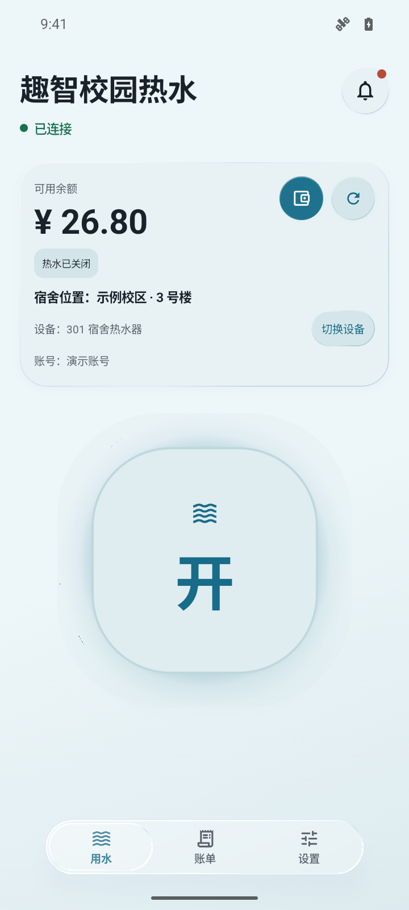 | 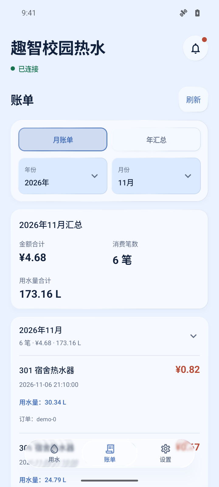 | 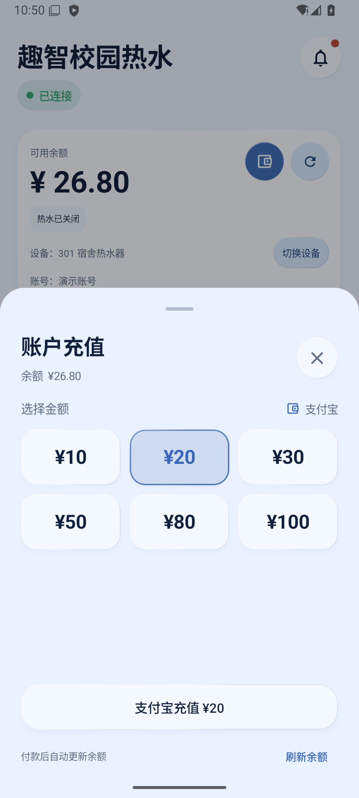 |

| 余晖 · 浅色 | 墨序 · 深色 | 开源支持 |
| :---: | :---: | :---: |
| 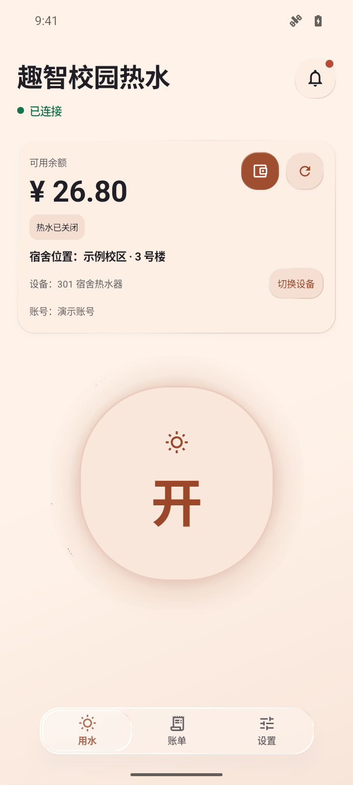 | 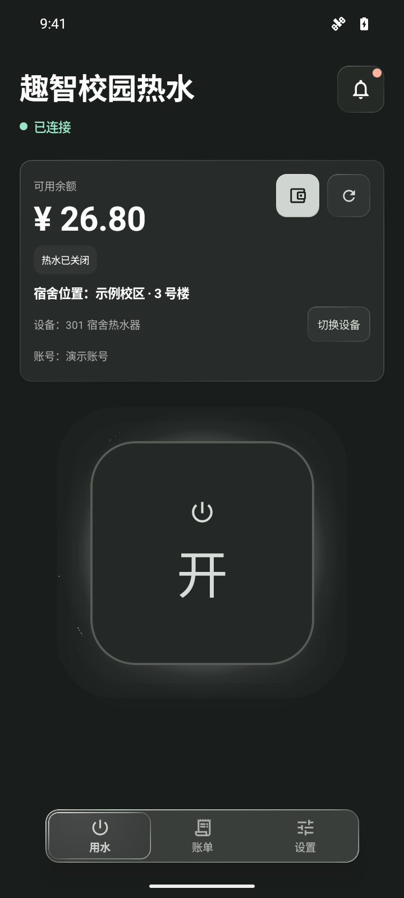 | 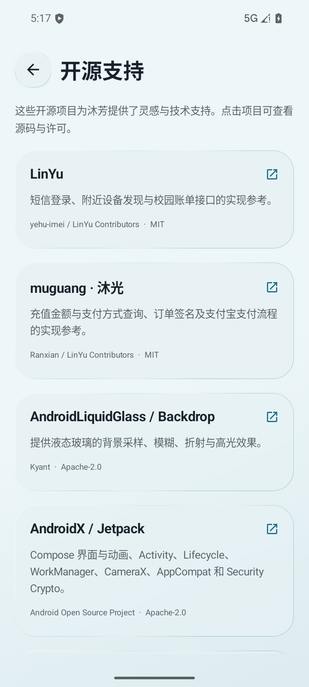 |

| 主题预览 | 自定义主题 | 关于应用 |
| :---: | :---: | :---: |
| 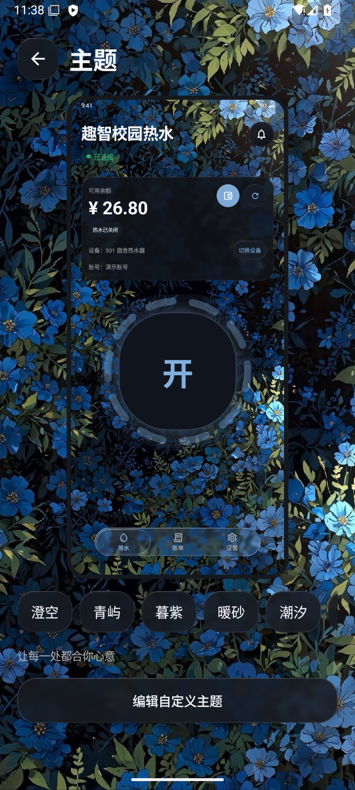 | 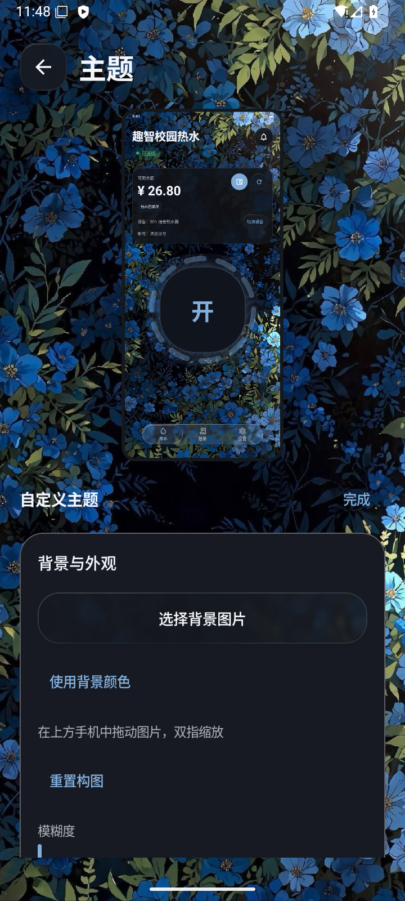 | 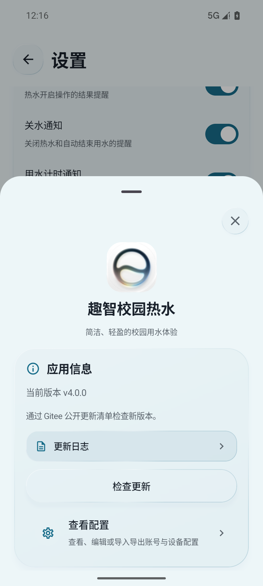 |

| 中文欢迎 | 桌面小组件 | 更新功能展示 |
| :---: | :---: | :---: |
| 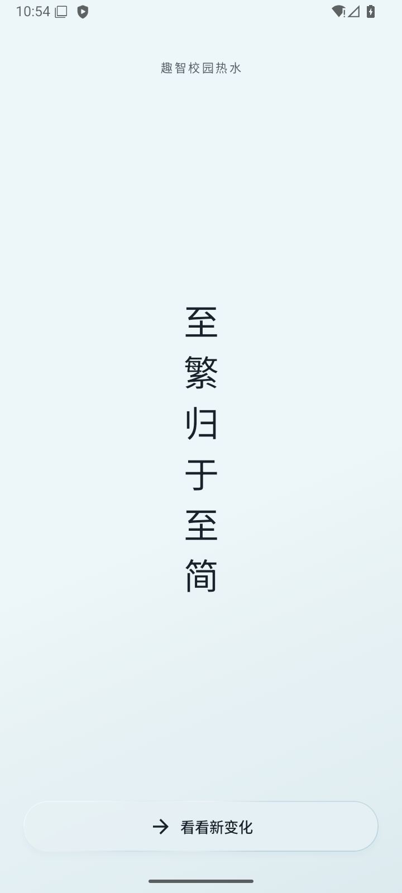 | 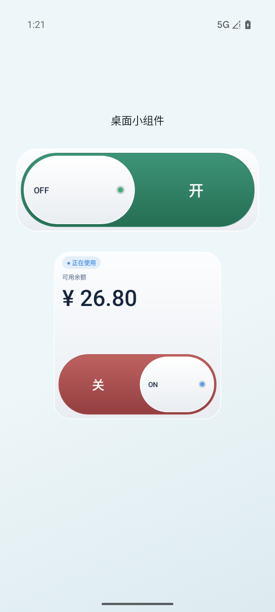 | 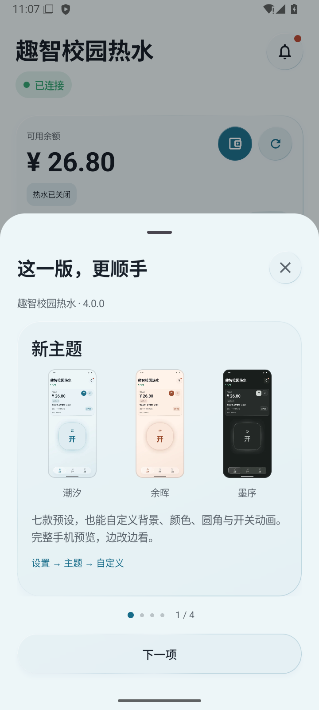 |

## Android 能做什么

- **日常用水**：首页查询余额、切换热水器和开关热水。连接状态区分绿色“已连接 / 正在使用”、黄色“设备使用中”和红色“离线”。
- **便捷登录与绑定**：短信验证码或密码登录；通过附近设备、扫码或手动输入绑定。登录失效时提供重新登录入口，同账号重新登录保留设备。
- **清楚的账单**：按月或按年查看服务器账单，汇总费用与用水量；部分数据未同步时明确提示，登录失效时可直接重新登录。
- **应用内充值**：从底部升起半屏面板，选择学校提供的金额，再拉起支付宝支付。返回后查询实际余额，不在本地虚增金额，也不自动重复下单。
- **消息与公告**：筛选校园消息、系统公告或全部消息；未读红点、一键已读、原生详情与公告回复。标题和时间只展示一次。
- **七套预设与自定义主题**：澄空、青屿、暮紫、暖砂、潮汐、余晖、墨序，支持浅色、深色与跟随系统。主题切换与子页面导航有过渡，液态玻璃强度可调；编辑时上方完整显示手机预览，下方调节图片背景、位置与模糊、颜色、圆角和开关动画。可直接在手机预览里拖动、双指缩放背景，实时预览模糊，自动从图片取色；使用色轮和明度滑杆选色。
- **桌面与系统入口**：2×1 横向滑动开关、2×2 状态胶囊、余额与滑动开关、4×2 状态小组件，以及快捷设置磁贴和用水通知。拟真滑块带四色状态灯，按可见内容去重刷新，避免周期性重建视图。
- **集中设置**：账户卡片提供修改密码与更换手机号；关于应用集中版本、配置及项目链接。震动反馈、开关水通知、计时与实况通知可分别设置；支持忽略当前更新版本、配置备份、问题反馈、项目网站和开源支持入口。
- **欢迎与更新引导**：首次安装和更新后，竖排“至繁归于至简”分两段显现并配震动。英文格言移入关于应用；四页更新介绍包括新主题、自定义主题、小组件和充值，全部附应用界面截图，最后点击“太棒啦！”。关于应用可重新查看。

更多实现细节见 [Android README](android_hotwater/README.md)。

## 平台与目录

| 平台 | 当前范围 | 入口 |
| --- | --- | --- |
| Android 8.0+ | Kotlin / Compose；本文截图与新增功能主要来自 Android | [android_hotwater](android_hotwater/) |
| HarmonyOS NEXT | ArkTS / ArkUI；登录、扫码绑定、热水控制、历史记录、服务卡片与配置备份 | [harmony_hotwater](harmony_hotwater/) |
| Windows / Python | 从自己的 Charles 抓包提取配置，用于兼容、接口验证与调试 | [qzxy_hotwater.py](qzxy_hotwater.py) |

两端独立迭代，Android 的充值、主题和消息功能不代表 HarmonyOS 已同步支持。HarmonyOS 源码版本为 2.3.1，构建与签名说明见其 [README](harmony_hotwater/README.md)。

## 开始使用

1. 从 [Gitee Releases](https://gitee.com/Solbrilo/quzhi-campus-third-party/releases) 下载对应 Android APK，或按平台文档自行构建。
2. 登录自己的趣智校园账号。Android 可使用短信验证码或密码登录。
3. 选择附近热水器，或扫描学校设备上的二维码；相机不可用时可以手动填写设备码。
4. 回到“用水”页面查看状态并操作设备。登录与绑定可以暂时跳过，之后在设置中补充。

实际支持的设备、充值金额和支付方式取决于学校。Android 的附近设备扫描用于发现和绑定，热水控制走云端接口，目前没有蓝牙直接开阀或洗衣机功能。

## 构建与验证

Android 使用 JDK 17、Android SDK 36 和项目自带 Gradle Wrapper：

```powershell
cd android_hotwater
.\gradlew.bat :app:assembleDebug
.\gradlew.bat :app:testDebugUnitTest
```

Debug 安装包位于 `android_hotwater/app/build/outputs/apk/debug/app-debug.apk`。Release 需要本机签名配置；不要提交 `local.properties` 或签名材料。HarmonyOS 的工具链与签名步骤见 [HarmonyOS README](harmony_hotwater/README.md)。

界面截图的离线复现方法见 [截图说明](docs/screenshots/README.md)。单元测试和模拟器截图不能替代真实设备、学校账号或充值到账验证。

## 数据与隐私

- 密码与短信验证码只在内存中参与登录或账户修改请求，不写入配置；Android 账号配置使用加密存储。
- 账号或设备切换会隔离旧订单和异步请求。关水后的待结算记录会继续同步，避免将未确认金额当作零消费。
- JSON 配置备份含运行凭据，只应保存在自己的设备上；抓包、签名材料和本地配置不应公开分享。
- Android 匿名使用统计始终开启，用于按日、月及应用版本汇总活跃安装数；不包含账号、手机号或硬件标识，详情见应用内隐私政策。
- 充值由趣智校园下单、支付宝完成支付。余额与到账状态以服务端为准。

## 开源参考

| 项目 | 本项目中的用途 | 许可 |
| --- | --- | --- |
| [LinYu](https://github.com/yehu-imei/linyu) | 短信登录、附近设备发现与账单接口参考 | MIT |
| [muguang · 沐光](https://github.com/Ranxian/muguang) | 充值套餐、订单签名与支付宝支付流程参考 | MIT |
| [AndroidLiquidGlass / Backdrop](https://github.com/Kyant0/AndroidLiquidGlass) | 液态玻璃背景采样、模糊、折射和高光 | Apache-2.0 |

许可与归属说明见 [THIRD_PARTY_NOTICES](android_hotwater/THIRD_PARTY_NOTICES.md)，也可在应用的“设置 → 关于应用 → 开源支持”查看项目入口。[与 muguang 的功能对比](android_hotwater/docs/muguang-comparison.md)记录了能力差异与参考范围。

本项目是第三方实现，与学校、设备运营方及趣智校园官方无隶属关系。账户、退款与设备运营问题请联系学校或官方客服。
