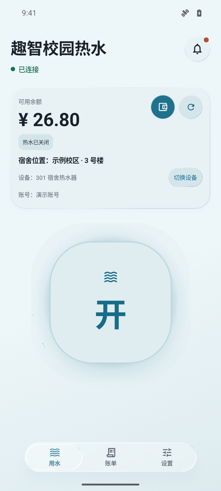
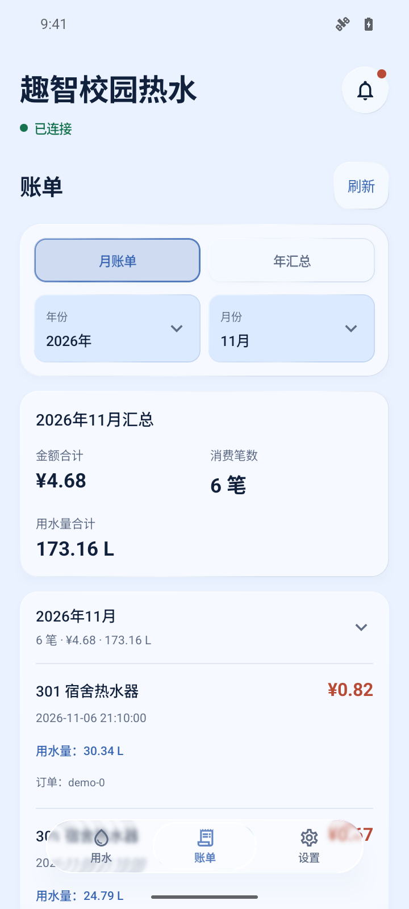
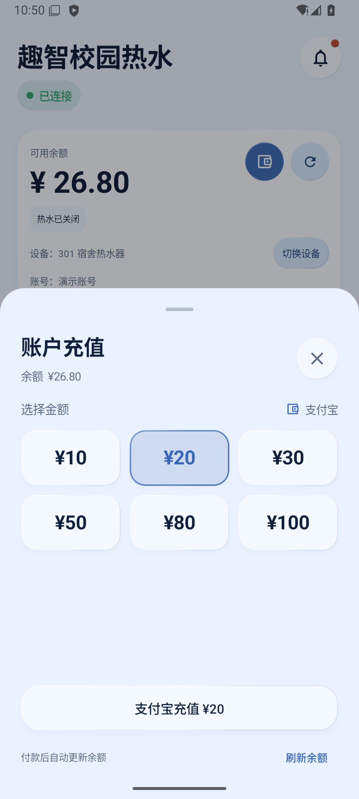
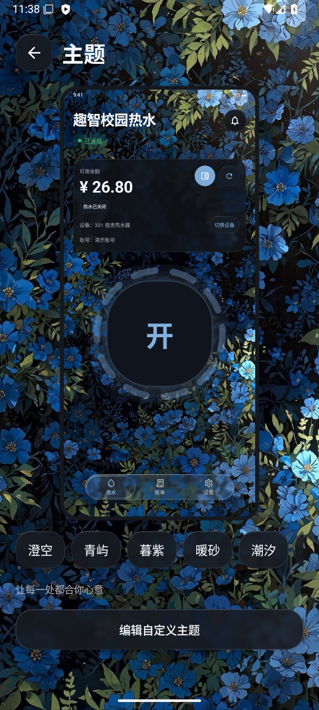
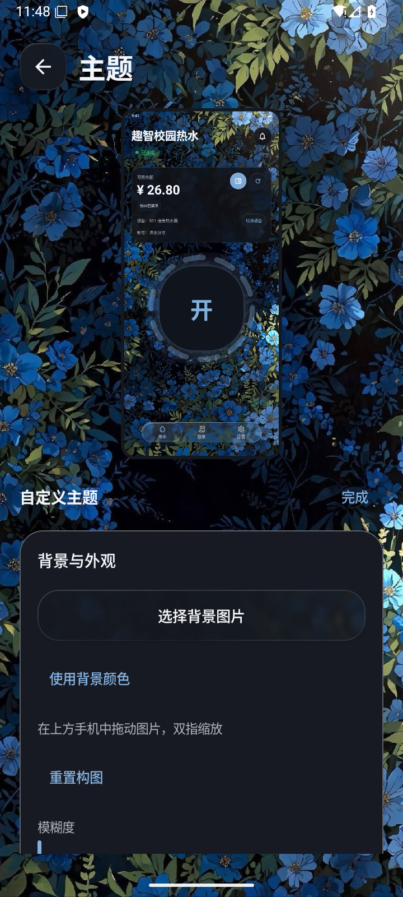
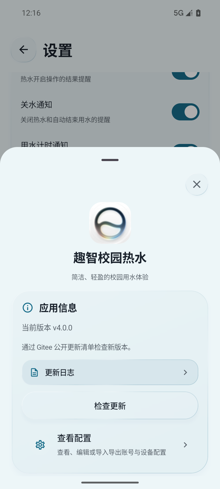

# Android 热水应用

这是趣智校园第三方热水控制项目的 Android 客户端。应用使用 Kotlin、Jetpack Compose 和 Material 3，最低支持 Android 8.0（API 26），compile/target SDK 为 36，当前源码版本字段为 `4.0.0 (31)`，构建使用 JDK 17。

[项目网站](https://nebularive.top/project-qzxy-hotwater.php) · [正式安装包](https://gitee.com/Solbrilo/quzhi-campus-third-party/releases) · [完整截图与使用介绍](../README.md)

本文描述当前开发源码，半屏充值、新主题等近期变更尚未全部包含在 v3.1.2 正式安装包中，请以 Release 说明为准。

## 界面预览

以下为当前源码在 Android 模拟器中的实际界面，设备、余额、账单与充值套餐均为演示数据。

| 用水 · 潮汐 | 账单 | 支付宝充值 |
| :---: | :---: | :---: |
|  |  |  |

| 主题预览 | 自定义主题 | 关于应用 |
| :---: | :---: | :---: |
|  |  |  |

## 当前功能

- “用水 / 账单 / 设置”三个主视图：查询余额和状态，开关热水、同步服务器账单，并管理显示与应用设置。
- 设置顶部为账户卡片，显示用户名和学校，提供登录/退出、修改密码（原密码或短信验证）与更换手机号。应用信息、日志、配置、制作者、开源支持和网站集中到“关于应用”半屏页。
- 右上角铃铛打开消息，支持全部 / 校园消息 / 系统公告筛选。公告可定时生效、弹窗、到期隐藏，可提交选择项或自由输入回复；应用进入前台及前台每分钟同步。
- 独立趣智校园登录页：默认短信验证码登录，可自由切换密码登录；验证码发送有 60 秒重发倒计时。
- 自动填写 `projectId`、`userId`、`accountId`、`loginCode` 和 `telephone`。
- BLE 附近设备列表：扫描热水器广播，向服务器核对设备信息后绑定；首页设备行可打开“切换设备”弹窗。
- 引导页优先显示附近设备列表，底部提供扫码配对。配置页保留原有 CameraX / ML Kit 扫码和手动输入。
- 首次安装及版本更新引导：“至繁归于至简”居中竖排，按“至繁”“归于至简”分两段显现，各配一次震动并遵循震动开关。英文格言移入关于应用。更新用户随后查看新主题、自定义主题、小组件、充值四页截图介绍，最后点击“太棒啦！”；也可从关于应用的“查看新功能”重新打开，关闭后直接进入主页；首次安装继续原有登录与绑定引导。支持减少动态效果，完成后本版本不重复显示。
- 登录和绑定均可跳过，稍后可以回到配置页继续完成。
- JSON 配置导入导出，导出文件使用不含账号信息或特殊字符的固定名称。
- 桌面小组件：`2x1` 横向滑动开关、`2x2` 极简控制和 `4x2` 完整状态。小组件使用系统深浅色外圈、拟真滑块与四色状态灯，2×2 上方显示状态胶囊和余额；只在可见状态改变时更新并复用视图。横向开关在关水时滑块居左，右侧绿色“开”可点击；开水后滑块居右，左侧红色“关”可点击。
- 半屏充值面板读取学校提供的套餐，确认后直接拉起支付宝，支付返回后向服务器查询余额。
- 七套预设主题与自定义主题，带手机外壳实时预览；编辑时完整预览固定在上方，下方滚动调节，在预览中拖动、双指缩放图片，模糊实时生效；色轮与明度滑杆选色，背景图片自动提取协调底色。自定义本机背景图片、背景颜色、主题色、圆角和开关动画（包括流转实时预览）；支持深浅色、主题过渡、子页面动效及玻璃强度调节。
- 设置中的“震动和通知”区域分别控制震动、开关水通知、计时及实况通知；提供项目网站和开源支持入口。
- 更新弹窗支持“忽略此版本”，自动检查在出现更新版本前不再重复提醒；手动检查仍能查看该版本。
- 首页状态胶囊与小组件指示灯使用绿（已连接/空闲）、蓝（正在使用）、黄（被占用）、红（离线），移除宿舍位置行。
- 三个主页面跟随手势连续滑动，底栏滑块同步；子页面独立背景和触摸区域，滚动卡片保留圆角与标题，内容消失后标题卡片才离场。
- 快捷设置磁贴、前台通知控制、操作历史、深色模式、震动和 Snackbar 反馈。
- 本地配置使用加密存储，密码不会写入配置。

## 登录实现

密码登录沿用原有表单协议：

```text
POST https://v3-api.china-qzxy.cn/user/login
version=1.1.11
phoneSystem=android
telephone=<手机号>
password=<MD5(UTF-8 密码) 的大写十六进制末 10 位>
type=0
```

验证码登录参考 LinYu 的协议，使用以下端点（不会保存验证码或记录请求正文）：

```text
GET /user/verification/code/get
telephone=<手机号>&typeId=3&platform=1&secret=<手机号前3位+后4位+klcx 的 UTF-8 MD5 小写摘要>

POST /user/registerAndLogin
telephone=<手机号>&smsCode=<6位验证码>&type=5&phoneSystem=android&version=6.5.24
```

验证码接口可能为未注册手机号创建账号，登录页已提示。切换登录方式或编辑输入会使旧登录结果失效；退出页面不会绕过重发倒计时。密码和验证码仅在内存中参与本次请求，不会持久化。登录成功后：

- 同一手机号重新登录会保留已有 `snCode` 和 MAC。
- 切换到不同手机号会清除旧设备码和 MAC，要求重新绑定。
- `loginCode` 正常轮换不会被当成账号切换，也不会误删当前活动订单。

## 附近设备与切换

- Android 12 及以上请求附近设备权限；Android 8–11 请求位置权限并要求系统位置信息开启，这是 BLE 扫描的系统要求。
- 仅显示广播名称含 `KLCXKJ-Water` 的设备，按信号排序，并使用 `GET /device/info/mac` 补充设备名称、位置和控制用 `snCode`。
- 这里的“配对”是应用内设备绑定。热水控制仍通过原有 HTTPS API，未增加 GATT 指令或系统蓝牙绑定操作。
- BLE 地址只用于查询，不覆盖配置里已有的 `macAddress` 字段；查询失败、响应缺少兼容设备码时不修改当前设备。
- 页面退出、切到后台或权限被关闭时停止扫描；旧扫描回调、旧账号查询不能覆盖新状态。
- 当前设备仍有活动用水或关水未确认时，禁止切走以保留停止入口。切换与小组件/通知控制共用设备操作锁；旧设备排队中的控制请求会失效。
- 不支持蓝牙、拒绝权限或未发现设备时，可在新手引导底部选择扫码配对，也可使用配置页的手动输入。

## 服务器账单

- 使用 `GET /order/query/account/bill/list?month=yyyy-MM&billRequestType=2`；解析 `consumeBillDTO`，账单金额按接口的“元”读取。
- 账单金额来自服务器，不由本地余额差额或操作历史推算。默认查看本月，通过月份/年份选择查询，可切换年度汇总；年度查询最多并发 3 个月，未来月份不请求。登录失效时显示明确提示和重新登录入口。
- 部分月份失败会显式提示汇总不完整；未知金额显示待同步，不当作零消费。账单汇总卡片和每笔记录展示用水量；接口提供水量时优先使用接口值，否则按 2.565 元/95 L、0.189 元/7 L 的统一单价估算并标注。
- 账号变更、清空数据和旧响应晚到均有隔离；设备切换不会更改账单所属账号。
- 保留开关水所需的订单、预授权余额保护、待结算存储和 WorkManager。它们保障控制与恢复，不再作为账单页数据源。

## 消息、材质及匿名统计

- 校园消息依据抓包协议请求 GET /project/push/list，读取 pushId、pushTitle、pushTime、pushContent、fullContent。抓包及凭据不进入源码。
- 打开应用时同步消息，首次成功同步建立历史基线；此后有新消息时提示并可进入详情。同批新消息提示最新一条，其余仍保留未读红点。
- 已读与提醒状态按账号隔离，本机保存；凭据轮换和换热水器不重置已读，换账号、退出和清空使旧请求失效。正文不执行远程脚本。
- 卡片、按钮和底栏使用 AndroidLiquidGlass / Backdrop 1.0.0 的背景采样、模糊、折射与高光。设置中的滑杆可调强度，0% 关闭；Android 13+ 支持完整折射，旧系统和高对比度模式使用兼容材质。
- 底栏采样页面内容，卡片采样独立背景，避免自引用绘制。依赖兼容现有 Kotlin 2.2.21，Compose UI/Foundation 随依赖解析至 1.9.4；AGP、SDK 和包名保持不变。
- 匿名统计始终开启，旧的关闭偏好不再生效。按日/月发送随机去重标识及应用版本；升级补报版本时不重复增加日活和月活。不含账号、手机号或硬件标识；口径为活跃安装数，不跨手机识别同一个人。清空数据会删除本机种子，再次打开时重新生成。服务器说明见 [统计与公告服务](../server/hotwater-activity/README.md)。

## 扫码绑定

支持的二维码示例：

```text
KLCXKJ-Water,M,C47F0EDA85D8
```

解析结果为最后一个字段 `C47F0EDA85D8`。解析器同时执行以下校验：

- 前缀必须为 `KLCXKJ-Water`，不区分大小写。
- 中间类型字段不能为空。
- 最后字段移除冒号后必须是 12 位十六进制字符，并统一转为大写。

扫码使用运行时 `CAMERA` 权限。相机不可用或拒绝权限时，可返回配置页手动填写 `snCode`。配置页扫码成功后自动回填但仍由用户确认保存；引导页扫码成功后自动保存并进入完成页。

## 新手引导

应用在本地记录已经完成引导的 `versionCode`。首次安装或版本更新后会先显示诗句，再按已保存配置恢复流程：

1. 居中竖排显示“至繁归于至简”，先显示“至繁”，再显示“归于至简”，每段一次震动。升级用户随后进入四页功能介绍；首次安装继续登录与绑定。
2. 趣智校园登录页，可选择“跳过登录”。
3. “绑定你的热水器”附近设备列表，选择设备完成绑定；底部可选择“扫码配对”或“暂时跳过”。
4. 绑定成功后的完成页，点击“立即开始”进入主界面；已有完整配置时直接完成引导，不再要求重新登录。

欢迎页的底部按钮首次安装时为“快速开始”、更新后为“看看新变化”，并始终固定在安全区动作栏中。

扫码配置正在保存时，返回和跳过操作会暂时禁用，避免异步保存结果推进错误的一轮引导。

## 打开与运行

1. 使用 Android Studio 打开当前目录。
2. 等待 Gradle 同步完成。
3. 让 Android Studio 配置本机 SDK，运行 Debug `app` 到真机或模拟器。
4. 需要 Release 时，再在本机配置 `RELEASE_STORE_FILE`、`RELEASE_STORE_PASSWORD`、`RELEASE_KEY_ALIAS`、`RELEASE_KEY_PASSWORD`，不要提交签名文件或口令。

相机硬件在 Manifest 中声明为可选。扫码功能建议在有后置摄像头的真机上验收，模拟器或无相机设备仍可使用手动配置。

## 测试与构建

在当前目录执行：

```powershell
.\gradlew.bat :app:testDebugUnitTest
.\gradlew.bat :app:assembleDebug
# 配置本机签名后，按需构建正式包
.\gradlew.bat :app:assembleRelease
```

单元测试覆盖登录协议、设备切换保护、服务器账单解析/请求乱序，以及原有订单结算回归。Compose 页面测试位于 `app/src/androidTest`，需连接设备或模拟器执行。Release APK 输出到：

```text
app/build/outputs/apk/release/app-release.apk
```

登录协议、二维码解析、版本引导门控、跨账号配置和订单身份判断均有单元测试覆盖。

## 使用小组件与快捷入口

1. 先在应用内完成登录与设备配置。
2. 长按桌面并添加“热水一键开关”小组件。
3. `2x1` 是独立的横向开关样式，`2x2` 仅显示开关按钮，`4x2` 额外显示状态、反馈和更新时间。
4. 可以从系统快捷设置中添加热水磁贴。
5. 更新版本后若桌面仍缓存旧布局，删除旧小组件后重新添加。

## 已知边界

- 某些 Android 版本会隐藏本机 Wi-Fi MAC，这是系统限制，应用会使用可获得的运行时设备信息。
- `loginCode` 失效后，可从设置或账单页的登录入口重新登录。
- Android 不导入 Charles `.chls`，但保留 JSON 配置备份的导入导出。
- 关水与消费到账可能不同步。应用保留待结算上下文继续同步，仅在满足确认条件时清理订单；短时间内不会恢复刚关闭的旧订单。
- 充值金额及支付宝通道以学校下发为准。支付处理中或结果未知时请先刷新余额确认，避免重复充值；模拟器预览不代表真实付款已验收。
- 自动化测试不替代真实短信收取、BLE 广播、学校服务器账单、扫码权限恢复和窄屏视觉验收。

## 协议参考

验证码登录、BLE 设备发现与账单接口参考 [LinYu](https://github.com/yehu-imei/linyu/tree/11eb9ec85c57bc2061ca49ee689d2efa12be5e2c)（MIT 许可），使用本工程的 OkHttp、配置与玻璃视觉组件重新集成；保留说明见 `THIRD_PARTY_NOTICES.md`。

## 充值与开源支持

- 首页和低余额提示中的充值入口打开从底部升起的半屏面板，金额套餐与支付宝通道由学校服务器提供。
- 确认金额后创建订单，通过官方支付宝 Android SDK 拉起支付。支付取消、处理中、未知结果分别提示；不会因返回成功而在本地增加余额，始终重新查询服务器。余额刷新不依赖热水器绑定。
- 下单时禁止重复提交；退出账号、切换账号或清空数据后，旧请求不能拉起支付或覆盖新账号的余额。支付订单仅保留在内存中。
- 设置页“项目仓库”上方新增“开源支持”，列出 LinYu、muguang、AndroidLiquidGlass / Backdrop 的用途、许可和源码入口。
- 校园消息详情只保留一份标题和发布时间，去掉正文开头重复的元信息，保留正文中的引用。
- 充值协议与签名参考 [muguang](https://github.com/Ranxian/muguang/tree/abd2f95f62d2724111fa3f7999aa793363dd2ac1)，许可见 `THIRD_PARTY_NOTICES.md` 及 APK 内的 `assets/licenses/Muguang-LICENSE.txt`。功能差异见 [对比记录](docs/muguang-comparison.md)。
