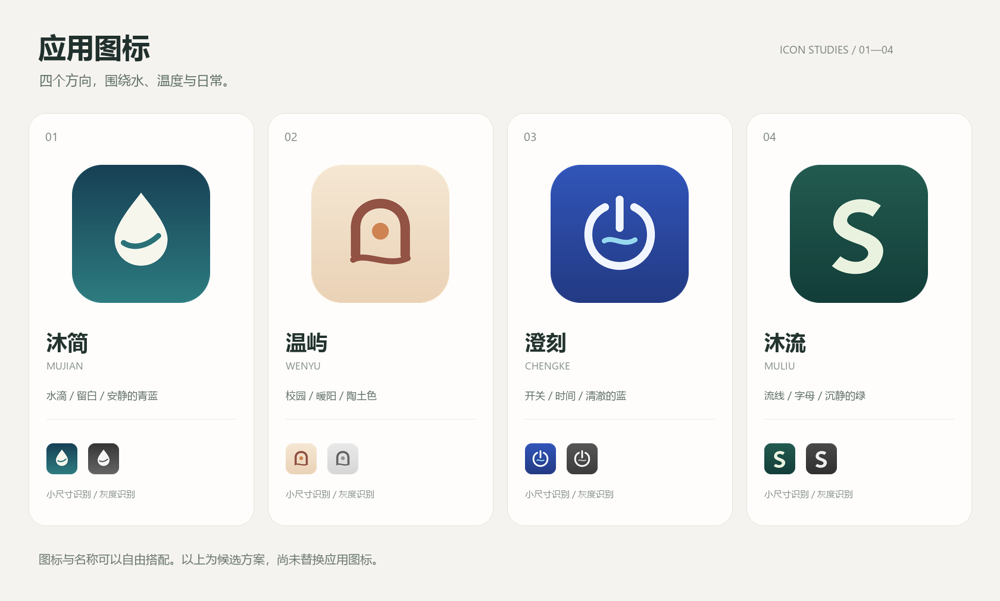

# 应用图标与名称候选

四套原创矢量方案。PNG 为 1024×1024；SVG 可继续修改和缩放。

| 方案 | 名称 | 设计方向 | 文件 |
| --- | --- | --- | --- |
| 1 | 沐简 | 更直观地表达用水，适合保留热水应用的辨识度。 | [SVG](01-mujian.svg) · [PNG](01-mujian.png) |
| 2 | 温屿 | 柔和温暖的校园意象，也适合拓展更多生活功能。 | [SVG](02-wenyu.svg) · [PNG](02-wenyu.png) |
| 3 | 澄刻 | 操作感鲜明，开关、水流与使用时长有统一的视觉联想。 | [SVG](03-chengke.svg) · [PNG](03-chengke.png) |
| 4 | 沐流 | 取自 Simplicity 的 S 流线，适合更简洁的品牌方向。 | [SVG](04-muliu.svg) · [PNG](04-muliu.png) |

推荐「沐简」：容易读记，表达用水功能，也呼应“至繁归于至简”。名称与图标可交叉选择。
补充名称：沐时、温序、一沐。

未更改应用名称、启动图标或资源。选定后可适配 Android 自适应图标安全区及单色图标。
