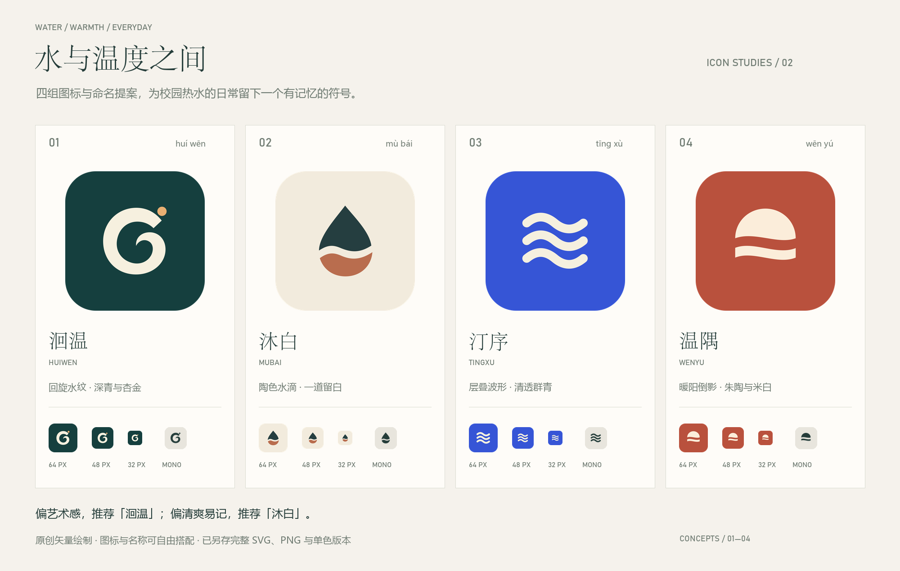

# 水与温度之间 · 图标与命名提案（第二轮）

四组原创矢量图标，围绕校园热水客户端的水流、温度与轻量日常。每组提供可编辑 SVG、1024×1024 PNG、圆角预览、透明前景、单色版与 512 / 64 / 48 / 32 像素预览。图标与名称可自由搭配。

本地打开 [index.html](index.html) 可并排比较，也可打开 [小尺寸与遮罩检查图](mask-and-size-check.png)。

## 01 · 洄温 / HUIWEN

把回旋的水流收成一笔，暖色圆点像留在水中的温度。

名称：“洄”是水流回旋，“温”点出热水；也借“回温”的读音，表达忙碌后回到舒适。

取向：偏艺术、安静而有辨识度；推荐作为主品牌方向。

配色：背景 `#153F3E`、主色 `#F6F0DF`。

[PNG 原图](01-huiwen.png) · [完整 SVG](01-huiwen.svg) · [透明前景](01-huiwen-foreground.svg) · [单色 SVG](01-huiwen-monochrome.svg)

## 02 · 沐白 / MUBAI

用一道有呼吸感的留白切开水滴，让水的清澈与陶器的温润相遇。

名称：“沐”联系沐浴，“白”是留白与清爽；呼应项目把操作变简单的气质。

取向：清爽、柔和、容易读记；推荐作为易传播的名称方向。

配色：背景 `#F2EBDD`、主色 `#253E40`。

[PNG 原图](02-mubai.png) · [完整 SVG](02-mubai.svg) · [透明前景](02-mubai-foreground.svg) · [单色 SVG](02-mubai-monochrome.svg)

## 03 · 汀序 / TINGXU

三条波形有相同的节奏，用几何秩序表达流动；像水纹，也像折叠的缎带。

名称：“汀”是水边，“序”是有序；适合强调顺手、清晰的校园生活工具。

取向：更现代、醒目；适合希望保留蓝色科技感的方向。

配色：背景 `#3655D6`、主色 `#F5F0DF`。

[PNG 原图](03-tingxu.png) · [完整 SVG](03-tingxu.svg) · [透明前景](03-tingxu-foreground.svg) · [单色 SVG](03-tingxu-monochrome.svg)

## 04 · 温隅 / WENYU

把一轮暖阳和水面倒影压缩成两个色块，保留版画般的安静与温度。

名称：“温隅”是日常里温暖的一角；比功能型名称更有陪伴感。

取向：温暖、有生活气息；适合向校园日常服务延展。

配色：背景 `#B9513D`、主色 `#FBEDDA`。

[PNG 原图](04-wenyu.png) · [完整 SVG](04-wenyu.svg) · [透明前景](04-wenyu-foreground.svg) · [单色 SVG](04-wenyu-monochrome.svg)

## 更多名称

| 名称 | 意象与适用方向 |
| --- | --- |
| 一沐 | 一次轻松的沐浴；短、直接、易记。 |
| 沐序 | 把校园用水安排得有序；偏工具气质。 |
| 涟间 | 水纹之间、日常片刻；偏文艺。 |
| 暖汀 | 水边的一点温暖；偏亲和。 |
| 澄一 | 清澈、专注、简单；偏克制。 |
| 沐和 | 沐浴与平和；偏温柔、舒适。 |

## 交付与适配说明

- 完整 SVG 和不带后缀的 PNG 使用不透明满版方形背景；`-preview.png` 是圆角演示，不应再用于叠加系统遮罩。
- `-foreground.svg` 为透明前景，`-monochrome.svg` / PNG 为真实单色前景。此处仅做概念层面的圆形与圆角遮罩检查，未写入正式平台资源；正式接入时需按各平台安全区校准前景尺寸。
- 应用名称与图标均为提案，未更改 Android / HarmonyOS 资源、包名、版本或应用代码。
- 名称未做商标、域名、应用商店重名检索；读音以普通话为准，其中“洄”读 huí，“汀”读 tīng。
- 重建：安装 `sharp` 后运行 `node build-concepts.cjs`；安装 Pillow 后运行 `python make-board.py`。
