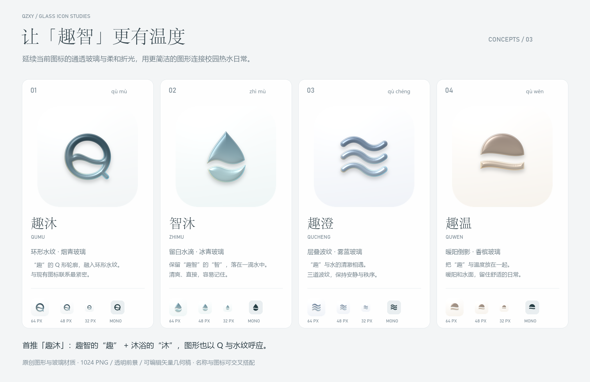

# 趣智校园关联命名 · 玻璃简约图标提案

本轮依据当前应用图标的玻璃质感制作：保留白瓷色背景、柔和厚度、冷暖边缘折光，并让名称与“趣智校园”建立联系。所有方案均为独立设计提案，未替换正式应用资源。

[打开本地方案画廊](index.html) · [查看原图对照、小尺寸与圆形遮罩检查](glass-size-and-mask-check.png)

## 首推：趣沐 / QUMU

“趣”承接趣智校园，“沐”直接联系沐浴与热水。名字短、易读，也让人联想到“去沐浴”。图标延续现有的环形水纹，右下角的轻微收笔组成 Q 的轮廓，呼应“趣”的首字母。

适合的品牌呈现方式：

- 应用名：**趣沐**。
- 简介：**趣智校园第三方热水客户端**。
- 视觉：烟青玻璃、白瓷底、极少量冷暖折光。

[1024 PNG 成稿](01-qumu.png) · [透明材质前景](01-qumu-foreground.png) · [可编辑几何 SVG](01-qumu-geometry.svg) · [玻璃效果 SVG 探索稿](01-qumu-glass.svg)

## 其余方案

| 名称 | 与趣智校园的联系 | 视觉方向 | 成稿 |
| --- | --- | --- | --- |
| 智沐 / ZHIMU | 保留“智”，用“沐”表达用水与沐浴。 | 留白水滴、冰青玻璃，清爽直接。 | [PNG](02-zhimu.png) · [SVG 几何稿](02-zhimu-geometry.svg) |
| 趣澄 / QUCHENG | 保留“趣”，“澄”联系清水，也表达清楚简单。 | 三道波纹、雾蓝玻璃，安静而有秩序。 | [PNG](03-qucheng.png) · [SVG 几何稿](03-qucheng-geometry.svg) |
| 趣温 / QUWEN | 保留“趣”，“温”表达热水与舒适。 | 暖阳倒影、香槟玻璃，更有生活温度。 | [PNG](04-quwen.png) · [SVG 几何稿](04-quwen-geometry.svg) |

更多名称：**沐趣、趣汐、趣润、智泉**。名称和图标可以交叉搭配。

## 文件说明

- `01-qumu.png` 等：1024×1024、满版不透明方形背景，玻璃材质成稿。
- `*-preview.png`：1024×1024 的透明圆角演示；用于展示，不宜再叠加平台遮罩。
- `*-512.png`、`*-64.png`、`*-48.png`、`*-32.png`：按实际像素导出的圆角预览。
- `*-foreground.png`：1024×1024 透明玻璃前景，不含底色和背景投影。
- `*-geometry.svg`：真正可编辑的矢量轮廓；单色形式，适合后续原生图标适配与继续编辑。
- `*-glass.svg`：使用 SVG 渐变和滤镜的玻璃探索稿。PNG 成稿经过额外的材质、边缘和光照渲染，与此 SVG 的表现不完全相同。
- `*-monochrome.png`：透明、真实单色前景，适合继续适配主题图标。
- `*-mask.png`、`*-vector-preview.png`：材质渲染的中间结果与矢量效果预览。
- `concepts.json`：名称、含义、配色与取向；`build-glass.cjs` 和 `render-glass.py` 保存了几何与材质的可重建源文件。

图形为原创矢量绘制，玻璃材质由局部形状、光照和折光渲染生成。本轮只保存方案文件，不修改 Android / HarmonyOS 名称、启动图标、包名、版本或代码。已做桌面尺寸和圆形遮罩预览；正式接入后仍应按各平台资源规范导出并查看设备效果。

名称尚未进行商标、应用商店或域名重名检索。

重建：为 Node.js 配置 `sharp`，运行 `node build-glass.cjs`；为 Python 配置 `Pillow`、`numpy`、`scipy`，运行 `python render-glass.py`。画板中文字体使用 Windows 系统字体。
