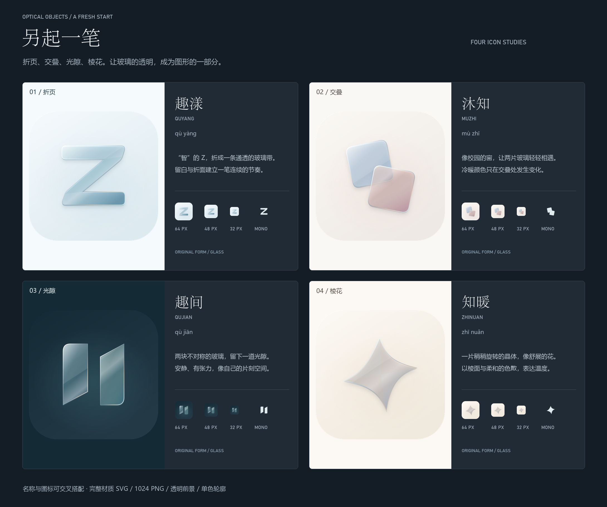

# 另起一笔 · 应用图标全新提案

全新四组设计，以折页、交叠、光隙、棱花为构图起点。保留艺术感、简洁和玻璃质感的要求，并重新探索与趣智校园有关的命名。

[打开方案画廊](index.html) · [小尺寸与遮罩检查](size-check.png)

## 01 · 趣漾 / 折页

把“智”的 Z 折成一条玻璃带，转折之间保留水的轻盈。

命名：保留趣智校园的“趣”，“漾”带出水与校园的活力。

艺术方向：以一笔连续的折面建立节奏，艺术性来自留白与折射的方向。

[PNG 成稿](01-quyang.png) · [完整材质 SVG](01-quyang.svg) · [透明前景](01-quyang-foreground.png) · [单色几何 SVG](01-quyang-geometry.svg)

## 02 · 沐知 / 交叠

两片错位的玻璃像校园的窗，把冷暖颜色交给交叠处。

命名：“沐”点出用途，“知”借“智”的同音，也联系校园与知性。

艺术方向：不把水画出来，以透明叠色与不对称平衡表达清澈、温润。

[PNG 成稿](02-muzhi.png) · [完整材质 SVG](02-muzhi.svg) · [透明前景](02-muzhi-foreground.png) · [单色几何 SVG](02-muzhi-geometry.svg)

## 03 · 趣间 / 光隙

两扇静立的玻璃之间留一束光，像忙碌校园里短暂的独处。

命名：“趣”联系趣智校园，“间”既是空间，也是一段自己的时间。

艺术方向：用两块不对称的体量与一道负空间完成构图，克制而有张力。

[PNG 成稿](03-qujian.png) · [完整材质 SVG](03-qujian.svg) · [透明前景](03-qujian-foreground.png) · [单色几何 SVG](03-qujian-geometry.svg)

## 04 · 知暖 / 棱花

一片轻轻旋转的晶体，像被温度舒展开的花。

命名：用“知”与“智”同音的联系，融入“知你冷暖”的日常关照。

艺术方向：让四个方向稍有偏转；光从棱面穿过，轮廓轻盈，中心安静。

[PNG 成稿](04-zhinuan.png) · [完整材质 SVG](04-zhinuan.svg) · [透明前景](04-zhinuan-foreground.png) · [单色几何 SVG](04-zhinuan-geometry.svg)

## 交付说明

- 每组的 PNG 为 1024×1024；无后缀文件使用满版方形背景，适合继续导出平台资源。
- 完整材质 SVG 使用可编辑路径、渐变与滤镜；PNG 直接由同一 SVG 渲染。
- `-preview` 是圆角展示版；`-foreground` 是含玻璃效果与轻投影的透明前景；`-geometry` 是单色可编辑轮廓。
- 另附 512、64、48、32 像素预览；正式接入前需按平台要求校准安全区并查看设备效果。
- 名称和图标可交叉搭配；名称尚未进行商标与应用商店重名检索。
- 本次只交付设计提案，不改动 Android / HarmonyOS 代码与正式图标。
- 重建：为 Node.js 配置 `sharp`，运行 `node build.cjs`；安装 Pillow 后运行 `python compose.py`。
