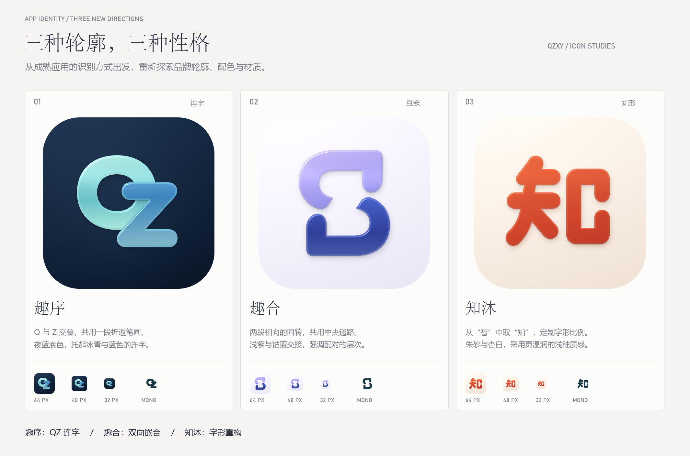

# 趣序 / 趣合 / 知沐

本轮研究了 Craft、Arc、Linear、Things、Raycast、Anytype、Structured 和 Gentler Streak 的图形与材质处理，再绘制三组独立路径。参考记录见 [references.md](references.md)。

[打开画廊](index.html) · [小尺寸与遮罩](size-check.png) · [单色轮廓](silhouette-sheet.png)

## 01 · 趣序 / 连字

从趣智 QZ 的字母结构出发：Q 的字腔与 Z 的折返交叠，共用右侧的一段笔画。两条笔画分别采用冰青与蓝色，交叠关系本身形成专属连字。

名称建议：沿用“趣智”的趣，把登录、绑定、用水与结算整理成顺手的日常秩序。

[1024 PNG](01-gate.png) · [透明前景](01-gate-foreground.png) · [矢量轮廓](01-gate-geometry.svg)

## 02 · 趣合 / 互嵌

从“互”的双向关系出发，重画两段相向的曲面：外侧饱满、内侧收窄，彼此留出同一条弯曲通路。上片轻透、下片深色，交接处显露材料厚度；项目联系来自真实的账户与设备配对。

名称建议：保留“趣”，用“合”联系账户与设备的绑定，也表达一次连接后的顺畅使用。

[1024 PNG](02-session.png) · [透明前景](02-session-foreground.png) · [矢量轮廓](02-session-geometry.svg)

## 03 · 知沐 / 知形

提取“智”上半部的“知”，用圆润而有收锋的专属字形重画。左侧是一段连贯笔画，右侧字腔留出清晰的纵向通路；朱砂与杏白的对比让它更像一枚当代字印，表面采用轻微釉光。

名称建议：“知”取自趣智的“智”的上半部，“沐”点出热水应用的日常用途。

[1024 PNG](03-confluence.png) · [透明前景](03-confluence-foreground.png) · [矢量轮廓](03-confluence-geometry.svg)

## 文件与再生成

- PNG：1024×1024 满版底图、圆角预览、透明前景，以及 512 / 64 / 48 / 32 像素小样。
- SVG：独立、可编辑的平面路径。PNG 中的表面明暗通过向量遮罩和法线计算生成，为静态材质表现。
- 完整满版底图：文件名不带后缀的 PNG；圆角预览只用于展示。
- marks.cjs：几何、配色、文案。
- render-masks.cjs：生成可编辑矢量与逐层遮罩。
- render-materials.py：根据遮罩的距离场计算圆角、表面法线和局部反光。
- compose.py：比较板、单色板、小尺寸与遮罩板。
- 配置 sharp、Pillow、numpy、scipy 后运行 node build.cjs。可通过 ICON_STUDY_PYTHON 指定 Python 路径。
- 本轮交付是设计研究；名称仍需重名与商标检索，平台接入时需进一步校准安全区。
